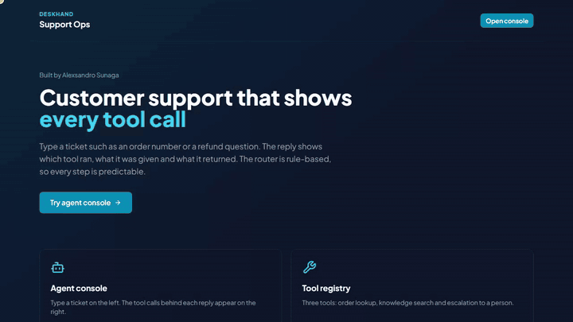
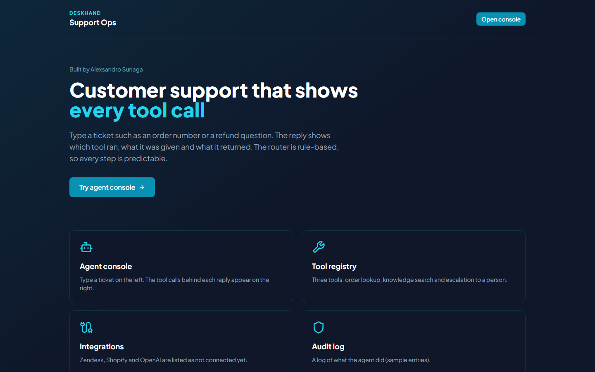
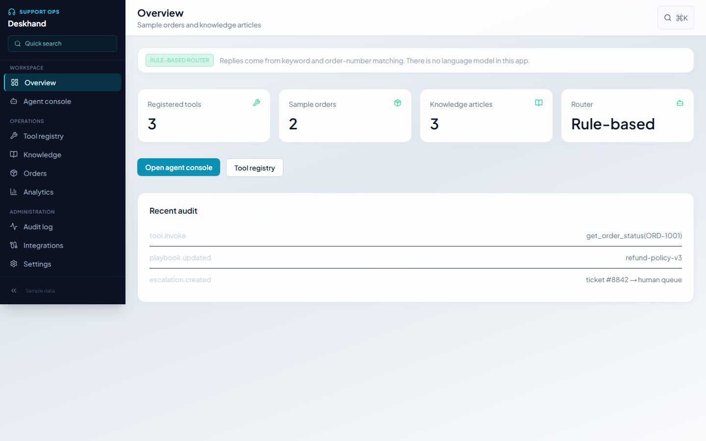
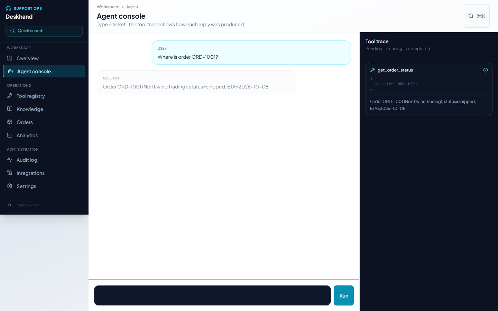
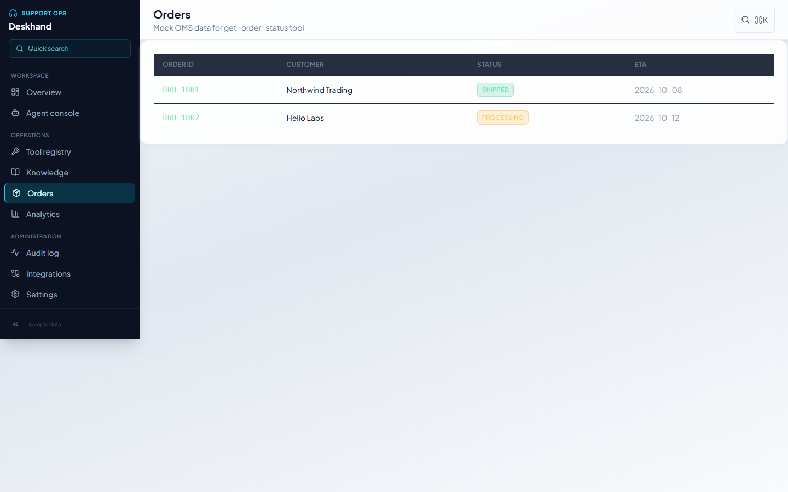

# Deskhand

## Demo

[](docs/demo/demo.mp4)

35 seconds, recorded from the running app: the landing page, an order lookup (`ORD-1001`), a refund-policy question and an escalation request, with the tool trace on the right for each reply, then the tool registry and the sample orders. The agent is rule-based, and the captions say so. [Watch the MP4](docs/demo/demo.mp4).

## Screenshots







**Support console · tool trace · rule-based agent**


**Next.js 15** console + **FastAPI** agent API. The router matches order numbers and keywords to three tools (order lookup, knowledge search, escalation) and returns the trace of each call. It does not use a language model; an LLM function-calling router is not included.

**GitHub topics:** `tool-calling`, `nextjs`, `fastapi`, `customer-support`

## Tech stack

| Area | Technologies |
|------|--------------|
| Frontend | `Next.js`, `React`, `TypeScript`, `Tailwind CSS`, `Radix UI`, `Framer Motion`, `Recharts`, `cmdk` |
| Backend | `Python`, `FastAPI`, `OpenAI tool-calling`, `Pydantic Settings`, `pytest` |

## Run

**API (FastAPI, port 8001)**

```bash
cd backend
python -m venv .venv && .venv\Scripts\activate
pip install -r requirements.txt
uvicorn app.main:app --reload --port 8001
```

**Console (Next.js, port 3001)**

```bash
npm install
set AGENT_API_URL=http://127.0.0.1:8001
npm run dev
```

- Marketing: http://localhost:3001  
- Console: http://localhost:3001/dashboard  
- Agent: http://localhost:3001/dashboard/agent  

Try: `ORD-1001`, refund policy, password reset, “escalate to human”.

## Console routes

Overview · Agent console (chat + tool trace) · Tool registry · Knowledge · Orders · Analytics · Audit · Integrations · Settings

⌘K command palette · collapsible sidebar · mobile nav

## Summary

Support agent with tool traces, KB + order tools, and ops dashboard (Next.js + FastAPI). The router is rule-based (keyword matching over the tool registry). An LLM function-calling router is not included.

## Tests

```bash
cd backend
pip install -r requirements.txt -r requirements-dev.txt
python -m pytest -q
```

## Author

**Alexsandro Sunaga**

## License

MIT License — Copyright (c) 2026 Alexsandro Sunaga. See [LICENSE](LICENSE).
